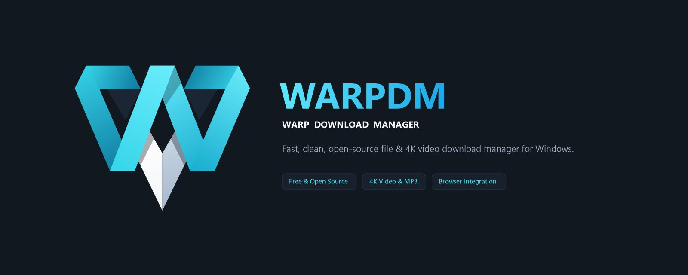
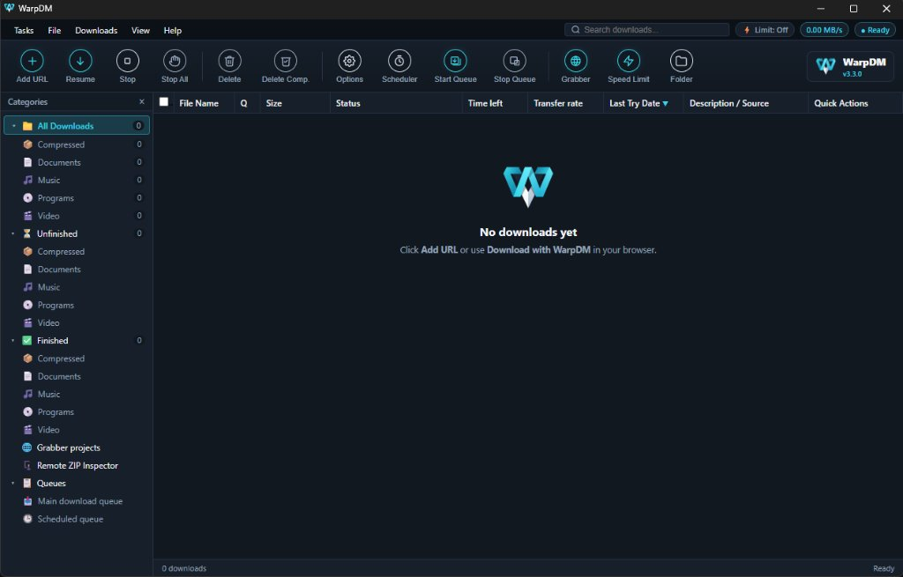

<div align="center">



# ⚡ WarpDM (`v3.5.0`)
### **Warp Download Manager — Fast, Clean Open-Source File & 4K Video Download Manager for Windows**

[](https://github.com/JossefHLV/WarpDM/releases)
[](LICENSE)
[-189ab4?style=for-the-badge)](#quick-install)
[](#why-warpdm)

**100% Free & Open Source** · **Zero Trial Popups** · **Multi-Connection File Accelerator** · **4K Video & MP3 Browser Integration**

[**⬇ Download Latest Installer (`WarpDMSetup.exe`)**](https://github.com/JossefHLV/WarpDM/releases/latest) · [**🌐 Browser Extension Setup**](#browser-extension) · [**📖 Architecture**](#architecture) · [**🤝 Contributing**](CONTRIBUTING.md)

</div>

---

## 🖥️ Desktop Interface Preview

<div align="center">
  
</div>

---

<a id="why-warpdm"></a>
## 🚀 Why WarpDM?

Traditional download managers either lock core capabilities behind paid licenses and intrusive registration nag screens, or lack modern browser video extraction and adaptive rate-limit handling.

**WarpDM (`Warp Download Manager`)** combines a classic, high-density **power-user desktop workflow** (hierarchical category tree, customizable draggable grid columns, multi-queue scheduler, per-transfer live segment HUD, and precision speed limiter) with a modern **zero-dependency ES Module + Win32 desktop architecture**:

- ⚡ **Dynamic Work-Stealing Multi-Segment Engine** — Splits large transfers across up to **32 parallel HTTP `Range` workers** and dynamically halves the largest remaining byte range in-place whenever a worker finishes early — zero reconnect overhead.
- 🛡️ **Adaptive HTTP 429 / 503 Shield** — Automatically steps down per-host concurrency on strict CDNs (e.g., Hetzner, cloud object stores) and resumes cleanly without dropping downloaded bytes.
- 🎬 **Universal 4K Video & MP3 Browser Pill (`Manifest V3`)** — CSP-immune ShadowDOM floating download button (`adoptedStyleSheets`) with Top-Layer mounting across **Chrome**, **Brave**, **Edge**, **Opera / GX**, **Vivaldi**, and **Firefox** on **YouTube (4K60 / Shorts / MP3)**, **Facebook Reels & Watch**, **Kick.com Live & Clip Modals**, **X (Twitter)**, **Instagram**, **TikTok**, **Reddit**, **Twitch**, and generic **HLS (`.m3u8`) / DASH (`.mpd`)** players — even inside Fullscreen & `<dialog>` modals.
- 🖥️ **4-Zone Power-User Desktop Interface** — Full Menu Bar (`Tasks`, `File`, `Downloads`, `View`, `Help`), Neon/3D/Compact Graphic Toolbars, Resizable Category & Queue TreeView, Draggable Custom-Width Grid Columns, Right-Click Context Menus, and **10 Instant UI Languages** (English, العربية, Français, Español, Deutsch, Türkçe, Русский, Português, 简体中文, 日本語).
- 🎯 **Precision Speed Limiter & Queue Scheduler** — Throttle transfers to an exact custom `KB/sec` or `MB/sec` ceiling (with optional auto-enable on startup), schedule daily `HH:MM` start/stop windows, and configure HTTP Basic Auth, custom User-Agents, per-category folders, and completion actions.
- 📦 **Remote ZIP Central Directory Inspector & Site Grabber** — Preview and selectively extract individual files inside multi-gigabyte remote `.zip` archives via HTTP tail-range reads without downloading the entire archive, or crawl whole directories with the built-in spider.

---

## 📊 Feature Comparison

| Capability | **WarpDM v3.5** | IDM | Free Download Manager | XDM |
| :--- | :---: | :---: | :---: | :---: |
| **License & Cost** | **MIT (100% Free)** | Paid / Shareware | Proprietary Freeware | Open Source |
| **Zero Nag Popups / Zero Ads** | ✅ | ❌ | ✅ | ✅ |
| **Dynamic In-Place Range Halving (32 Conns)** | ✅ | ✅ | ✅ | ⚠️ Static |
| **Adaptive CDN `HTTP 429` Concurrency Step-Down** | ✅ | ❌ | ❌ | ❌ |
| **4K YouTube / X / Kick / Facebook / TikTok + MP3** | ✅ Built-in | ⚠️ Stream-only | ❌ | ⚠️ Partial |
| **CSP-Immune Fullscreen & `<dialog>` Video Pill** | ✅ | ✅ | ❌ | ❌ |
| **Remote `.ZIP` Selective File Extraction** | ✅ | ❌ | ⚠️ Preview | ❌ |
| **Exact `KB/s` & `MB/s` Token-Bucket Speed Limiter** | ✅ | ✅ | ✅ | ✅ |
| **Crash-Safe SQLite WAL Byte-Exact Resume** | ✅ | ✅ | ✅ | ⚠️ JSON |

---

<a id="quick-install"></a>
## 📥 Quick Install

### Option A: One-Click Windows Installer (Recommended)
1. Download **`WarpDMSetup-v3.5.0-x64.exe`** from the [**Releases**](https://github.com/JossefHLV/WarpDM/releases/latest) page.
2. Run the setup wizard (no Administrator elevation required — installs cleanly to `%LOCALAPPDATA%\Programs\WarpDM`).
3. Launch **WarpDM** and click the **`Browser`** button on the toolbar for simple Copy & Paste extension setup (`Chrome`, `Brave`, `Edge`, `Opera`, `Vivaldi`, and `Firefox`).

<a id="browser-extension"></a>
### 🌐 Browser Extension (Chrome / Brave / Edge / Opera / Vivaldi / Firefox)
- **Guided Copy & Paste Setup**: Click the **`Browser`** button on the WarpDM toolbar to copy your browser's Extensions URL (`chrome://extensions`, `brave://extensions`, `edge://extensions`, `opera://extensions`, `about:debugging`) and the exact extension folder path in one click.
- **Firefox Support**: Includes a dedicated `WarpDM-Firefox.xpi` / `extension-firefox` Manifest V3 package alongside the Chromium extension.

---

## 🛠️ Build from Source

Prerequisites: **Windows 10/11 x64** and **PowerShell 5.1+**.

```powershell
# 1. Clone the repository
git clone https://github.com/JossefHLV/WarpDM.git
cd WarpDM

# 2. Fetch the portable runtime binaries (Node.js 24, yt-dlp, FFmpeg) into ./runtime/
powershell -ExecutionPolicy Bypass -File .\scripts\fetch-runtime.ps1

# 3. Run the automated test suite
.\runtime\node.exe --test tests/*.test.mjs

# 4. Compile WarpDM.exe + self-contained WarpDMSetup.exe installer
powershell -ExecutionPolicy Bypass -File .\Build-Installer.ps1
```

---

## 💻 Command-Line Interface (`warpdm`)

WarpDM also ships with a full headless CLI for terminal power users and automation scripts:

```bash
# Multi-segment accelerated download with 16 connections
node src/cli/hogra.mjs download "https://fsn1-speed.hetzner.com/100MB.bin" -c 16 -o ./downloads

# Inspect remote HTTP headers, file size, and Range support
node src/cli/hogra.mjs probe "https://example.com/archive.zip"

# Preview contents of a remote ZIP archive without downloading it
node src/cli/hogra.mjs zip-preview "https://example.com/release.zip"

# Crawl a web page/directory for downloadable assets
node src/cli/hogra.mjs grab "https://example.com/files/" --depth 2
```

---

<a id="architecture"></a>
## 🏗️ Architecture & Work-Stealing Engine

```
┌─────────────────────────────────────────────────────────────────────────┐
│  Chromium MV3 Extension (content.js + background.js)                    │
│  • CSP-proof ShadowDOM Floating Video Pill + Top-Layer Modal Mounting   │
│  • Dual-phase webRequest HLS/DASH/MP4 Sniffer + Scoped Cookie Bridge    │
└───────────────────────────────┬─────────────────────────────────────────┘
                                │ HTTP REST + WebSocket (127.0.0.1:20888)
┌───────────────────────────────▼─────────────────────────────────────────┐
│  WarpDM Native Desktop Shell (WinForms System Tray + Dedicated AppWin)  │
│  • Main 4-Zone Desktop Window  • Approval Dialog  • Live Progress HUD   │
└───────────────────────────────┬─────────────────────────────────────────┘
                                │
┌───────────────────────────────▼─────────────────────────────────────────┐
│  WarpDM Core Engine (Node.js 24 Built-in node:sqlite WAL + Streams)     │
│  • DownloadSession: Dynamic In-Place Work-Stealing + 80ms Smooth Tick   │
│  • TokenBucketLimiter: Exact Global + Per-Transfer Bandwidth Shaping    │
│  • YtdlpSession: Unauth-First 4K Extraction + FFmpeg MP4/MP3 Pipeline   │
│  • RemoteZipReader: HTTP Tail-Range EOCD Parser & Deflate Extractor     │
└─────────────────────────────────────────────────────────────────────────┘
```

---

## 📜 License

Released under the [MIT License](LICENSE). Built by [**JossefHLV**](https://github.com/JossefHLV).
